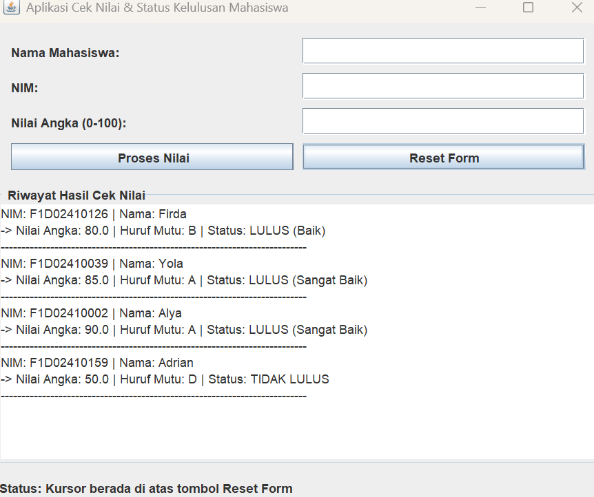
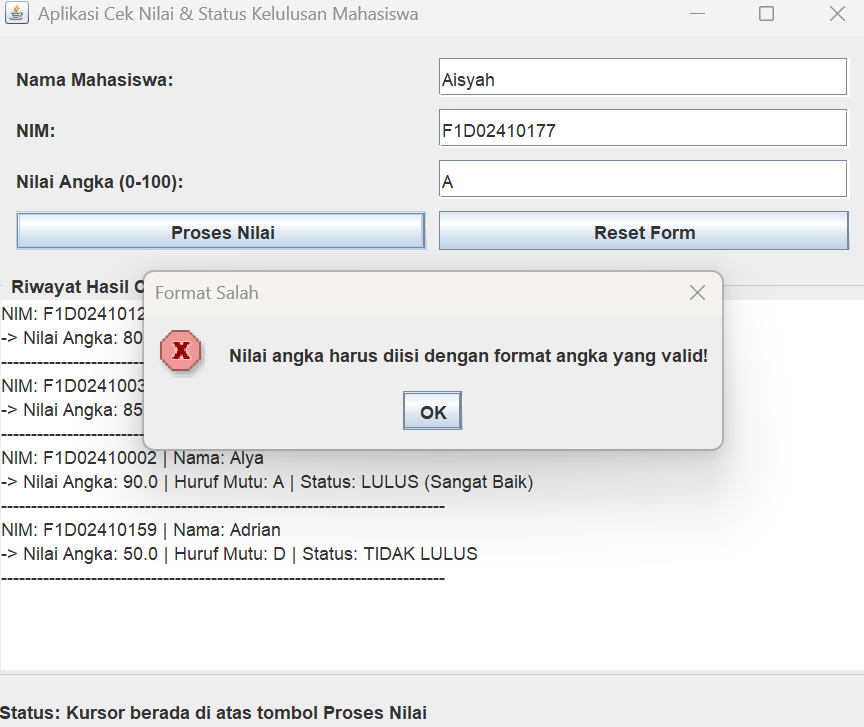

# Aplikasi Cek Nilai & Status Kelulusan Mahasiswa

## Mustafida
### F1D02410126

---

## Komponen GUI yang Digunakan

Sesuai dengan ketentuan tugas, aplikasi ini mencakup 5 elemen utama GUI:

### 1. Top Level Container
* **`JFrame`**: Digunakan sebagai jendela utama (*window*) aplikasi penampung seluruh komponen visual.

### 2. Intermediate Component
* **`JPanel`**: Digunakan sebagai wadah pengelompokan komponen form input agar tersusun rapi.
* **`JScrollPane`**: Digunakan untuk membungkus `JTextArea` agar riwayat hasil pengecekan nilai dapat digulir (*scroll*) apabila datanya sudah banyak.

### 3. Atomic Component
* **`JLabel`**: Menampilkan teks informasi seperti judul label form (*Nama*, *NIM*, *Nilai Angka*) dan status bar di bagian bawah.
* **`JTextField`**: Kotak input teks satu baris untuk memasukkan data Nama, NIM, dan Nilai Angka mahasiswa.
* **`JButton`**: Tombol interaktif untuk mengeksekusi aksi (`Proses Nilai` dan `Reset Form`).
* **`JTextArea`**: Area teks multi-baris yang bersifat *read-only* untuk menampilkan riwayat hasil perhitungan huruf mutu dan status kelulusan.

### 4. Layout Manager
* **`BorderLayout`**: Digunakan pada `JFrame` utama untuk membagi tata letak menjadi 3 bagian: `NORTH` (Form Input), `CENTER` (Riwayat Output), dan `SOUTH` (Status Bar).
* **`GridLayout`**: Digunakan pada `JPanel` form untuk menyusun label dan teks input secara teratur dalam bentuk grid 4 baris dan 2 kolom.
* **`FlowLayout`**: Digunakan secara implisit pada beberapa pengaturan penataan komponen pendukung.

### 5. Event Handling (Minimal 2 Interface)
* **`ActionListener`**: Menangani aksi klik pada tombol `Proses Nilai` (untuk memvalidasi angka, menghitung predikat A/B/C/D/E, serta menentukan status kelulusan) dan tombol `Reset Form`.
* **`MouseListener`**: Menangani interaksi kursor *mouse* (*hover*) saat mendekati area tombol (`mouseEntered` dan `mouseExited`) untuk memperbarui teks status bar secara dinamis.

---

## Fitur Aplikasi
1. **Validasi Input Kosong**: Memberikan peringatan (*popup dialog*) jika kolom nama, NIM, atau nilai belum lengkap.
2. **Validasi Rentang Nilai**: Memastikan nilai angka yang dimasukkan berada di antara `0` sampai `100` serta menggunakan format angka yang valid.
3. **Konversi Huruf Mutu & Kelulusan Otomatis**:
   * **Nilai >= 85**: Huruf Mutu **A** — *LULUS (Sangat Baik)*
   * **Nilai >= 70**: Huruf Mutu **B** — *LULUS (Baik)*
   * **Nilai >= 55**: Huruf Mutu **C** — *LULUS (Cukup)*
   * **Nilai < 55**: Huruf Mutu **D/E** — *TIDAK LULUS*
4. **Riwayat Interaktif**: Menampilkan daftar hasil pengecekan secara berurutan di dalam kotak riwayat.
5. **Indikator Status Bar Dinamis**: Berubah secara *real-time* ketika kursor menyentuh tombol atau saat data berhasil diproses.

---

## Cara Menjalankan Program

1. Pastikan komputer kamu sudah terinstal **JDK (Java Development Kit)**.
2. Buka terminal atau Command Prompt (CMD) di dalam folder penyimpanan file proyek.
3. Kompilasi file kode program Java:
   ```bash
   javac MainFile.java
4. ketik lagi agar bisa jalan:
   ```bash
   java MainFile 

## Output dari program

